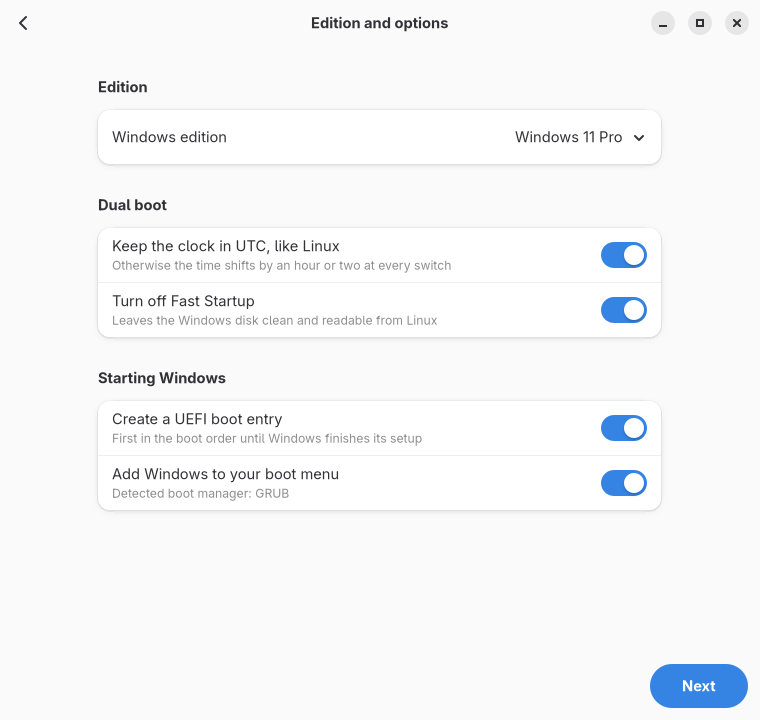
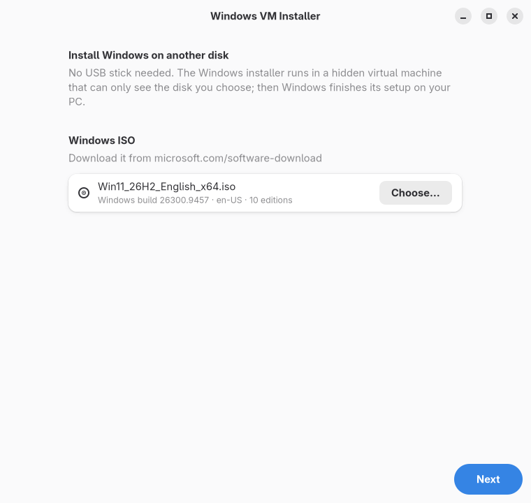
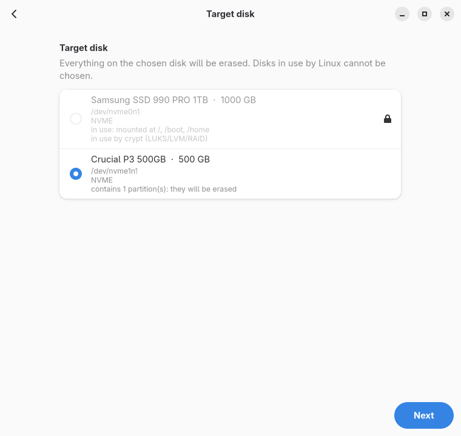
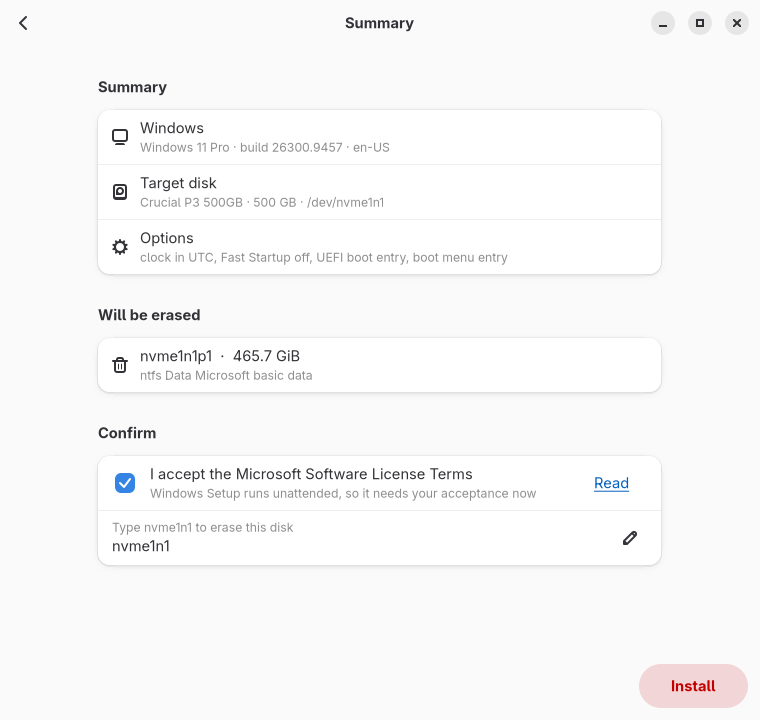
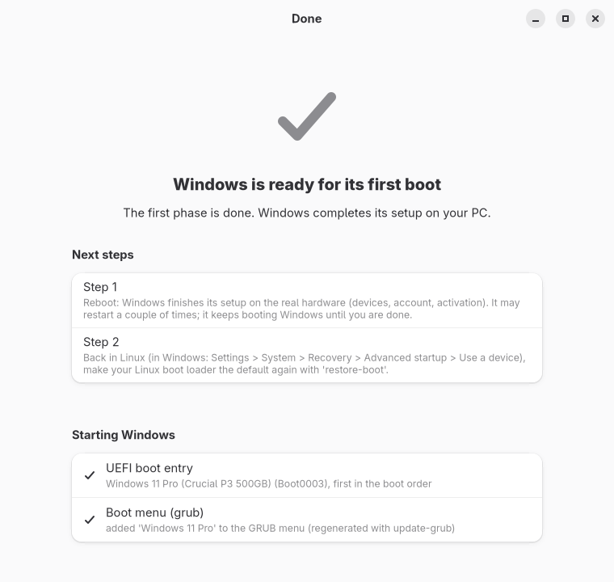

# windows-vm-installer

Install Windows onto a physical disk **from Linux, without a USB stick**.

The Windows installer runs inside a hidden QEMU/KVM virtual machine that can see
**only the target disk**. When its first phase is done, you reboot into the new
disk and Windows finishes the setup on the real hardware: drivers, account,
activation.

<p align="center">
  <picture>
    <source media="(prefers-color-scheme: dark)" srcset="docs/screenshots/gui-3-options-dark.png">
    
  </picture>
</p>

> Status: early development (0.1.0.dev0), tested on disk image files. Use at
> your own risk and keep backups: the target disk is erased.

## Why

- **No USB stick, no firmware settings.**
- **Your Linux disk is safe**: the installer cannot see it, so it cannot erase
  it or put its boot files on it. A disk is refused when it is mounted, used as
  swap, part of LUKS/LVM/RAID, a member of a mounted btrfs filesystem or a ZFS
  pool, holds the EFI partition the system boots from, or when the kernel
  reports it as busy; the check is repeated right before anything is written.
- **Windows gets its own EFI system partition** on its own disk, instead of
  writing into Linux's ESP.
- **Pick the edition you are licensed for**: if your firmware carries an OEM
  key (often Home), the regular installer silently picks that edition; in the VM
  you choose, and Windows activates on the first native boot.
- **Dual-boot friendly**: the Windows clock is set to UTC like Linux and Fast
  Startup is turned off (both optional), and Windows is added to the menu of
  the boot manager you use (Limine, GRUB, rEFInd).

## The graphical installer

`windows-vm-installer gui` runs as your normal user and asks for administrator
rights through polkit only when the installation starts. Six steps:

<table>
  <tr>
    <td width="50%"><picture>
      <source media="(prefers-color-scheme: dark)" srcset="docs/screenshots/gui-1-iso-dark.png">
      
    </picture><br><b>1.</b> Choose the ISO: editions, build and language are read from it</td>
    <td width="50%"><picture>
      <source media="(prefers-color-scheme: dark)" srcset="docs/screenshots/gui-2-disk-dark.png">
      
    </picture><br><b>2.</b> Choose the disk: disks used by Linux are locked, with the reason</td>
  </tr>
  <tr>
    <td><picture>
      <source media="(prefers-color-scheme: dark)" srcset="docs/screenshots/gui-3-options-dark.png">
      
    </picture><br><b>3.</b> Edition, dual-boot options, boot entry and boot menu</td>
    <td><picture>
      <source media="(prefers-color-scheme: dark)" srcset="docs/screenshots/gui-4-summary-dark.png">
      
    </picture><br><b>4.</b> Summary, what gets erased, license acceptance, disk name to confirm</td>
  </tr>
  <tr>
    <td><picture>
      <source media="(prefers-color-scheme: dark)" srcset="docs/screenshots/gui-5-progress-dark.png">
      
    </picture><br><b>5.</b> The installation runs hidden; progress comes from the disk writes</td>
    <td><picture>
      <source media="(prefers-color-scheme: dark)" srcset="docs/screenshots/gui-6-done-dark.png">
      
    </picture><br><b>6.</b> Done: next steps, boot entry and boot menu result</td>
  </tr>
</table>

## How it works

1. The edition list is read straight from the ISO (UDF + WIM metadata).
2. An `autounattend.xml` limited to the windowsPE pass is written to a small
   virtual CD: language, disk layout (EFI, MSR, Windows), edition, license.
3. QEMU starts headless with OVMF (Secure Boot capable) and a software TPM 2.0,
   the target disk on the same kind of controller it has in the PC (NVMe or
   SATA), the Windows ISO and the answer CD. `-no-reboot` makes QEMU exit at
   the installer's first reboot.
4. The result is verified on the disk itself: GPT, EFI system partition,
   `bootmgfw.efi` and `BCD`.
5. A UEFI boot entry is created and put first, so the installer's own reboots
   keep going to Windows. `restore-boot` puts your previous order back.
6. Windows is added to the menu of the boot manager you actually use, detected
   from the UEFI entry the PC booted with:
   - **Limine** managed by `limine-entry-tool` (CachyOS): `limine-update`
   - **Limine**: an entry appended to `limine.conf` (refused if the config hash
     is enrolled in the Limine binary, since editing it would stop Limine)
   - **GRUB**: a script in `/etc/grub.d` that chainloads `bootmgfw.efi` from the
     Windows ESP, then `update-grub` / `grub-mkconfig` (no os-prober needed)
   - **rEFInd**: nothing to do unless `scanfor` excludes internal disks
   - **systemd-boot**: cannot start loaders on another ESP; use the firmware menu

   Files are backed up to `/var/lib/windows-vm-installer/backups` first.

The out-of-box experience (account, privacy, network) is left to you on the real
hardware, so BitLocker and activation bind to the real machine, not to the VM.
The dual-boot settings are applied by Windows itself on that first boot; the
test notes in [docs/DEVELOPMENT.md](docs/DEVELOPMENT.md) show them checked in the
registry.

## Requirements

- x86-64 PC booted in UEFI mode, with virtualization enabled (`/dev/kvm`)
- Python 3.10+, QEMU (`qemu-system-x86_64`), OVMF/edk2 firmware, `swtpm`,
  `efibootmgr`, util-linux 2.37+ — all common distro packages, e.g. on Arch:
  `pacman -S qemu-desktop edk2-ovmf swtpm efibootmgr`
- For the graphical installer: PyGObject with GTK 4 and libadwaita 1.5+
  (`pacman -S python-gobject gtk4 libadwaita`) and a running **polkit
  authentication agent**. Full desktops (GNOME, KDE, Xfce…) start one; on
  minimal compositors such as niri, sway or Hyprland start one yourself
  (polkit-gnome, lxqt-policykit, soteria…). Without it the GUI shows the
  equivalent terminal command.
- A Windows 10/11 x64 ISO from <https://www.microsoft.com/software-download/windows11>
- A target disk of at least 64 GB, connected through NVMe or SATA (not USB)

## Usage

Graphical installer, as your normal user:

```sh
windows-vm-installer gui
```

Command line:

```sh
sudo windows-vm-installer list-disks
windows-vm-installer inspect-iso Win11.iso
sudo windows-vm-installer install --iso Win11.iso
# ...reboot, finish Windows setup, come back to Linux, then:
sudo windows-vm-installer restore-boot
# add a Windows that is already installed to your boot menu:
sudo windows-vm-installer add-to-bootloader --disk /dev/disk/by-id/nvme-... --title "Windows 11"
```

`install` asks for the disk and the edition, shows a summary, asks you to accept
the Microsoft license terms and to type the disk name before erasing it. Every
question has a command line option (`--disk`, `--edition`, `--accept-eula`,
`--yes`); see `windows-vm-installer install --help`. With `--json` it prints
one event per line instead (this is how the GUI follows it).

Run from a checkout without installing: `PYTHONPATH=src python3 -m wvi gui`, or
`sudo env PYTHONPATH=src python3 -m wvi ...` for the command line.

## Development

```sh
PYTHONPATH=src python3 -m unittest discover -s tests
# full run on an image file, no root needed:
PYTHONPATH=src python3 -m wvi install --iso Win11.iso --test-image /var/tmp/test.img
PYTHONPATH=src python3 -m wvi gui --test-image /var/tmp/test.img
# GUI screenshots, off screen (GTK Broadway backend); add --iso and --test-image
# for an end-to-end run of the GUI with a real installation into the image
PYTHONPATH=src python3 tools/gui_screenshots.py --out docs/screenshots --scheme light
```

---
## Support

If this project helped you and you’d like to support it ❤️:

[](https://paypal.me/capasotta)

---
## License

Copyright (C) 2026 Geraldino Mandragora

This program is free software: you can redistribute it and/or modify it under
the terms of the GNU General Public License as published by the Free Software
Foundation, either version 3 of the License, or (at your option) any later
version. See [LICENSE](LICENSE).

Windows is a trademark of Microsoft. This project is not affiliated with
Microsoft; Windows itself is licensed under Microsoft's own terms, which you
accept during the installation.
